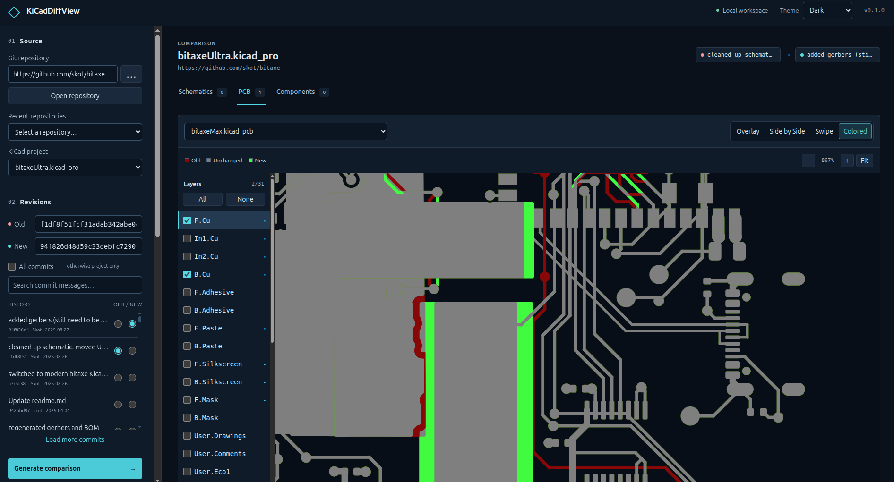
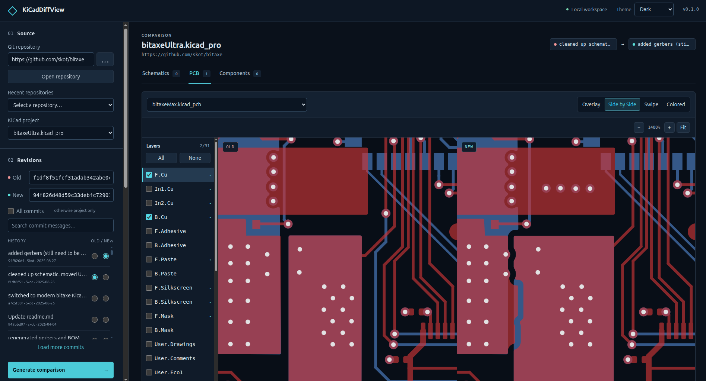

# KiCadDiffView

KiCadDiffView is a web app for comparing a KiCad project between two Git commits. Review schematic and PCB changes in **Overlay**, **Side by Side**, **Swipe**, or **Colored** views, and inspect component changes in a searchable table. Choose projects and commits in your browser using a local Git repository or an imported public HTTPS repository.

Local repositories are mounted **read-only**. Downloaded repositories, generated comparisons, and temporary files are stored separately in the `data` directory.






## Quick start

You need Docker and Bash on Linux or WSL. Clone this repository, open its directory, then run:

```bash
./build_docker_image.sh
./run.sh /path/to/repositories
```

Replace `/path/to/repositories` with an existing Git repository or a directory containing several repositories. The Docker image includes KiCad 9 and the other runtime dependencies; the first build requires internet access.

Open **http://localhost:8080**, select a repository, a KiCad project, and two commits, then generate a comparison. To import a public repository, use **Browse repositories → Public Git URL**. The directory argument is still required for this workflow and can point to an existing empty directory.

Stop the container with **Ctrl+C**. Data is preserved between runs. To change the port or data directory:

```bash
PORT=9090 DATA_DIR=/path/to/data ./run.sh /path/to/repositories
```

Keep the data directory separate from the source repository tree. The service is also available at `http://<server-ip>:8080` on your local network or VPN; it has no built-in authentication.

## Supported projects

Modern KiCad projects using `.kicad_pro`, `.kicad_sch`, and `.kicad_pcb` files are supported. Comparisons use committed revisions. Public repository imports support anonymous HTTPS; private remote repositories, automatic submodule checkout, and Git LFS downloads are not currently supported.

## License

[MIT](LICENSE).
